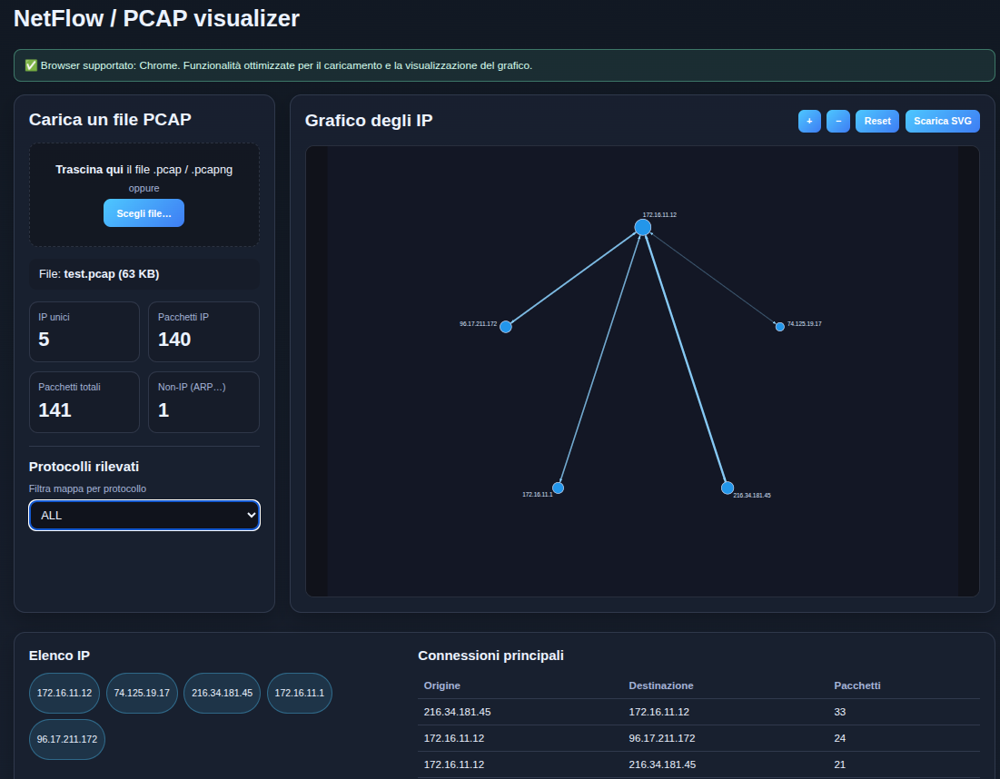

# SimpleNetFlow

<p align="center">
  
</p>

A lightweight web application for uploading PCAP and PCAPNG capture files, extracting IP conversations, and visualizing the communication graph in a navigable SVG diagram.

The project is built with Python and Flask, and it is designed to run locally or in Docker for quick packet inspection and traffic analysis.

## Overview

This tool allows you to:

- upload a packet capture file from the browser
- analyze IPv4 and IPv6 conversations without external libraries such as Scapy
- detect the most active IP pairs
- render a graph with nodes, edges, traffic volume, and SVG export
- inspect the result through a simple web interface

It is especially useful for quick traffic reviews, debugging capture files, and understanding which hosts talk to each other.

## Features

- upload of `.pcap`, `.pcapng`, and `.gz` captures
- support for large packet captures up to 2 GB (default upload limit: `MAX_UPLOAD_MB=2048`)
- automatic detection of capture format by content rather than extension
- support for Ethernet, VLAN/QinQ, MPLS, PPPoE, loopback, raw IP, and Linux cooked capture formats
- IPv4 and IPv6 traffic analysis
- background processing with progress updates in the UI
- SVG graph with zoom, pan, and download support
- unique IP list and connection table sorted by packet volume
- health check endpoint for service monitoring
- Docker support for easy deployment

## Tech Stack

- Python 3
- Flask
- Docker / Docker Compose
- Custom streaming PCAP parser

## Requirements

- Python 3.10+
- pip
- Docker and Docker Compose (optional, for containerized use)

## Quick start

### Local execution

```bash
python3 -m venv .venv
. .venv/bin/activate
pip install -r requirements.txt
python app.py
```

Then open:

```text
http://localhost:9977
```

## Docker deployment

```bash
docker compose up --build
```

Then open:

```text
http://localhost:9977
```

To verify that the service is running:

```bash
curl -s http://localhost:9977/health
```

## Environment variables

| Variable | Default | Description |
| --- | --- | --- |
| `PORT` | `9977` | Web server port |
| `UPLOAD_DIR` | `/app/uploads` | Temporary upload directory inside the container |
| `MAX_UPLOAD_MB` | `2048` | Maximum upload size (2 GB / 2 GiB) |
| `MAX_TRACKED_PAIRS` | `0` | Maximum number of distinct IP pairs tracked; `0` disables the cap |
| `MAX_PARALLEL_ANALYSES` | `2` | Maximum concurrent jobs |
| `MAX_GRAPH_NODES` | `0` | Maximum nodes rendered in the SVG graph; `0` disables the cap |
| `MAX_GRAPH_EDGES` | `0` | Maximum edges rendered in the SVG graph; `0` disables the cap |
| `FLASK_DEBUG` | `0` | Set to `1` for debug mode |

## Project structure

```text
.
├── app.py                 # Flask server and graph generation
├── pcap_parser.py         # Streaming PCAP/PCAPNG parser
├── requirements.txt       # Python dependencies
├── Dockerfile             # Container definition
├── docker-compose.yml     # Local Docker orchestration
├── static/
│   ├── app.js             # Frontend interaction logic
│   └── styles.css         # UI styling
├── templates/
│   └── index.html         # Main page
├── tests/
│   └── test_parser.py     # Parser tests
├── uploads/               # Temporary capture storage
└── README.md
```

## Usage

1. Open the web interface.
2. Upload a capture file. The default supported size is up to 2 GB per file.
3. Wait for the analysis to complete.
4. Explore the graph, inspect the IP list, and download the SVG file when needed.

The app processes the file in the background and exposes job state through the web UI via polling.

> Large capture files are supported by design; if needed, increase or reduce the `MAX_UPLOAD_MB` environment variable before publishing or deploying the service.

## Troubleshooting

- If the upload does not start, verify that the app is running on the expected port.
- If the file is rejected, check whether it is a valid PCAP/PCAPNG capture or a truncated file.
- If the graph is too crowded for large captures, increase or disable the graph limits via environment variables.

## Future improvements

- temporal traffic view
- PNG export
- support for NetFlow-style stream analysis


